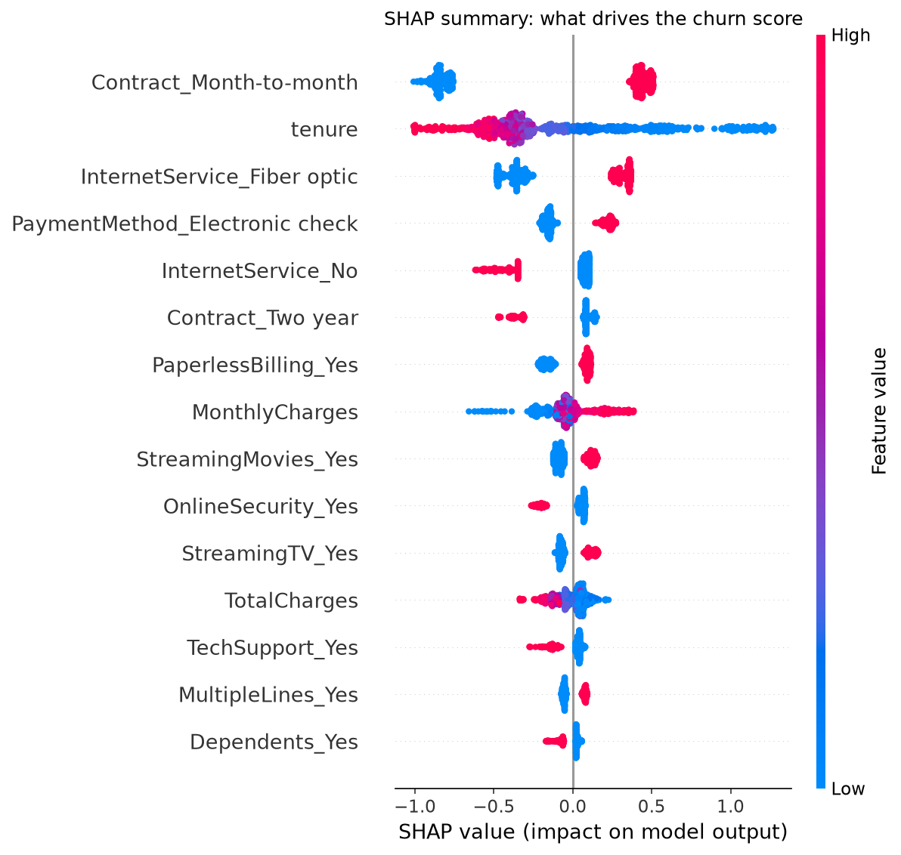
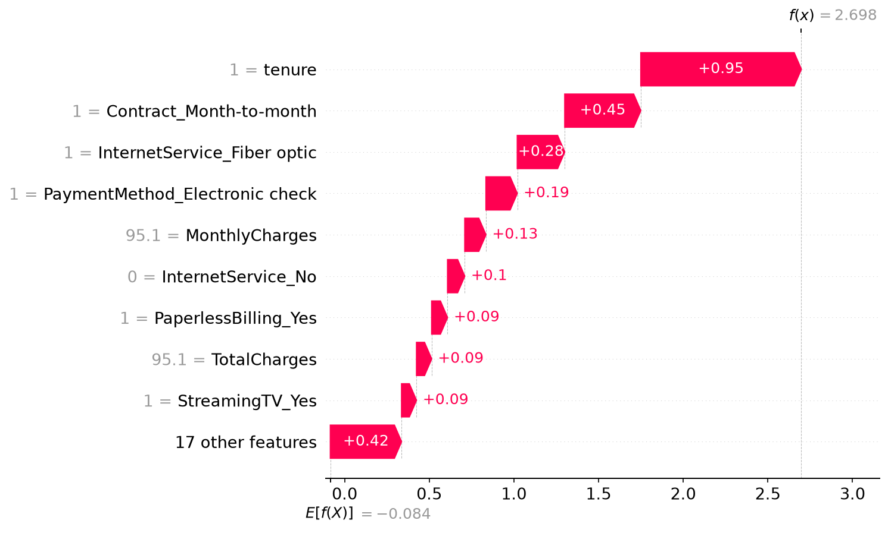

## Problem Statement

Telecom companies lose revenue when customers cancel their subscriptions. This project predicts which customers are likely to leave and suggests preventive actions so the company can retain them.

## Business Objectives

1. Identify customers likely to leave.
2. Understand the reasons behind churn.
3. Compare different ML algorithms.
4. Prioritize high-risk customers.
5. Help businesses improve customer retention.
6. Build a documented, reproducible, freely deployable system.

## Dataset

**IBM Telco Customer Churn Dataset**

- Customers: 7,043
- Original columns: 21
- Churn rate: Approximately 26.5%
- Target variable: `Churn` (binary classification)

## Models Compared

- Logistic Regression
- Decision Tree
- Random Forest
- Gradient Boosting
- XGBoost

## Tech Stack

Python, Pandas, NumPy, Matplotlib, Seaborn, Scikit-learn, XGBoost, SHAP, Joblib, FastAPI, Streamlit, Git and GitHub.

The project uses free-tier tools and services.

## Project Structure

See the repository folder layout for the complete project structure.

## Setup

```bash
git clone <your-repo-url>
cd churn-prediction-system

python -m venv venv

# Windows
venv\Scripts\activate

# macOS / Linux
source venv/bin/activate

pip install -r requirements-dev.txt
```

## Project Status

- [x] Phase 1: Setup and planning
- [x] Phase 2: Data understanding
- [x] Phase 3: Exploratory Data Analysis (EDA)
- [x] Phase 4: Data preprocessing and feature engineering
- [x] Phase 5: Model comparison and cross-validation
- [x] Phase 6: Model selection and threshold tuning
- [ ] Phase 7: SHAP explainability and driver-to-action recommendations
- [ ] Phase 8: FastAPI backend
- [ ] Phase 9: Streamlit frontend
- [ ] Phase 10: Deployment
- [ ] Phase 11: Final documentation

## Results

### Model Evaluation Results

#### Cross-Validation Performance

All five models were evaluated using 5-fold Stratified Cross-Validation with identical folds.

| Model | CV ROC-AUC | CV PR-AUC |
|---|---:|---:|
| Logistic Regression | 0.8484 | 0.6675 |
| Gradient Boosting | 0.8461 | 0.6601 |
| Random Forest | 0.8453 | 0.6622 |
| XGBoost | 0.8392 | 0.6583 |
| Decision Tree | 0.8268 | 0.6089 |

### Model Comparison


### ROC Curves


## Model Explainability – SHAP

SHAP (SHapley Additive exPlanations) is used to understand how customer features influence the model's churn risk scores.

### SHAP Summary Plot

The summary plot provides a global view of feature contributions and shows how different customer characteristics influence churn risk.



### SHAP Waterfall Plot

The waterfall plot explains an individual customer's prediction by showing how different features contribute to increasing or decreasing the model's churn risk score.



### Driver-to-Action Recommendations

SHAP explanations are combined with exploratory data analysis to translate churn-risk drivers into possible customer-retention strategies.

| Driver | Average SHAP Effect | EDA Evidence | Suggested Action | How to Test |
|---|---:|---|---|---|
| Month-to-month contract | [Add SHAP value] | [Add churn rate vs one-year contract] | Offer a discount for a one-year contract | A/B test offer vs no offer |
| Short tenure (≤ 12 months) | [Add SHAP value] | [Add churn rate vs longer-tenure customers] | Schedule an onboarding call and welcome offer | Compare called vs not-called customers |
| Fiber optic service | [Add SHAP value] | [Add churn rate vs DSL] | Review service quality and pricing | Customer survey and plan check-up |
| No tech support | [Add SHAP value] | [Add churn rate vs customers with support] | Offer a free technical-support trial | Trial group vs control group |
| Electronic check | [Add SHAP value] | [Add churn rate vs mailed check] | Offer an incentive to switch to auto-pay | Incentive vs no-incentive group |

*Note: SHAP values and EDA percentages should be populated using the actual project results. Positive SHAP values indicate contributions towards higher model churn scores.*

## Live Demo

To be added after Phase 10.

## Limitations

- Free-tier hosting may sleep after inactivity, so the first request can be slow.
- Customer features may be correlated, which can cause overlapping or shared SHAP contributions.
- SHAP values explain model behaviour; they do not establish why a customer actually churns.
- EDA findings show associations rather than causation.
- Suggested retention actions are hypotheses and should be tested through controlled experiments before being treated as effective business strategies.
- The churn-risk score is a model score and should not automatically be interpreted as a calibrated probability.

## Future Improvements

- Complete SHAP-based customer explanations.
- Improve customer-specific retention recommendations.
- Build a FastAPI prediction service.
- Develop an interactive Streamlit dashboard.
- Deploy the complete system using free-tier hosting.
- Monitor model performance and prediction quality over time.
