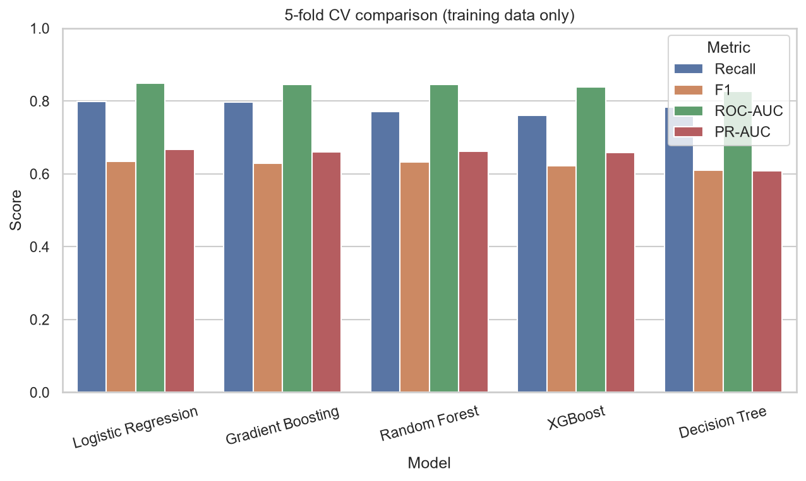
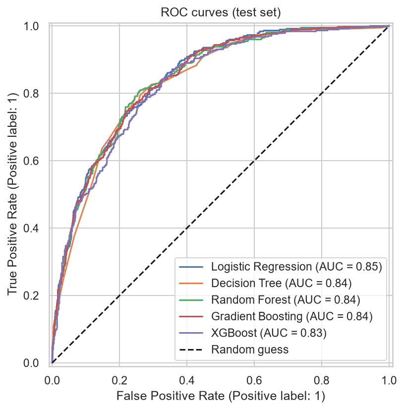

# Customer Churn Prediction System

## Problem Statement
Telecom companies lose revenue when customers cancel their subscriptions.
This project predicts which customers are likely to leave and suggests
preventive actions so the company can retain them.

## Business Objectives
1. Identify customers likely to leave.
2. Understand the reasons behind churn.
3. Compare different ML algorithms.
4. Prioritize high-risk customers.
5. Help businesses improve customer retention.
6. Build a documented, reproducible, freely deployable system.

## Dataset
IBM Telco Customer Churn dataset: 7,043 customers, 21 columns,
about 26.5% churn. Target variable: `Churn` (binary classification).

## Models Compared
Logistic Regression, Decision Tree, Random Forest, Gradient Boosting, XGBoost.

## Tech Stack
Python, Pandas, NumPy, Matplotlib, Seaborn, Scikit-learn, XGBoost, SHAP,
Joblib, FastAPI, Streamlit, Git/GitHub. All free-tier.

## Project Structure
(see folder layout)

## Setup
```bash
git clone <your-repo-url>
cd churn-prediction-system
python -m venv venv
source venv/bin/activate
pip install -r requirements-dev.txt
```

## Project Status
- [x] Phase 1: Setup and planning
- [ ] Phase 2: Data understanding
- [ ] Phase 3: EDA
- [ ] Phase 4: Preprocessing
- [ ] Phase 5: Model comparison
- [ ] Phase 6: Model selection and threshold tuning
- [ ] Phase 7: SHAP explainability
- [ ] Phase 8: FastAPI backend
- [ ] Phase 9: Streamlit frontend
- [ ] Phase 10: Deployment
- [ ] Phase 11: Documentation

## Results
## Model Evaluation Results

### Cross-Validation Performance

All five models were evaluated using 5-fold Stratified Cross-Validation with identical folds.

| Model | CV ROC-AUC | CV PR-AUC |
|---|---:|---:|
| Logistic Regression | 0.8484 | 0.6675 |
| Gradient Boosting | 0.8461 | 0.6601 |
| Random Forest | 0.8453 | 0.6622 |
| XGBoost | 0.8392 | 0.6583 |
| Decision Tree | 0.8268 | 0.6089 |

### Model Comparison



### ROC Curves




## Live Demo
(to be added after Phase 10)

## Limitations
Free-tier hosting may sleep after inactivity, so the first request can be slow.